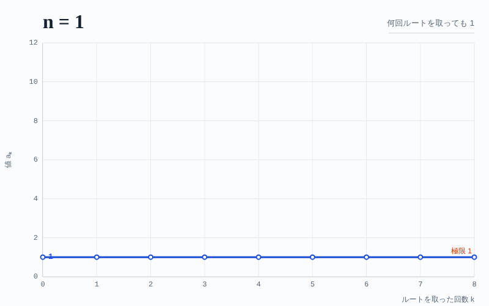

# 反復平方根ビューア

自然数 n にルートを繰り返し取ったときの値 aₖ = n^(1/2ᵏ) を可視化する Web アプリです。

- **1つの自然数で調べる**: 横軸がルートを取った回数 k、縦軸が値 aₖ のグラフと数値表を表示します。縦軸を「aₖ − 1（対数軸）」に切り替えると、1 との差が毎回ほぼ半分になる様子が見えます。
- **n を変えるとグラフはどう動くか**: 指定した範囲の自然数（例: 1〜10）を順に描くアニメーションを再生し、800×500 の GIF として保存できます。

外部ライブラリは使っていません（GIF エンコーダーも `index.html` 内に実装）。フォントは Google Fonts から読み込みます。

## GitHub Pages で公開する

1. このフォルダの中身（`index.html`, `README.md`, `sample_n1-10.gif`, `.nojekyll`）をリポジトリのルートに置きます。
2. リポジトリの **Settings → Pages** を開き、**Source** を「Deploy from a branch」、**Branch** を `main` / `/ (root)` にして保存します。
3. 1〜2 分後に `https://<ユーザー名>.github.io/<リポジトリ名>/` で公開されます。
